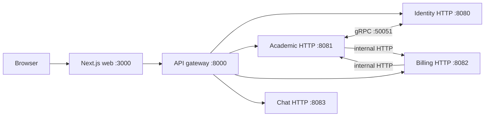

# KelolaKelas current-state documentation

**Implemented (KEL-225):** existing active system Teachers can accept another tenant's system Teacher invitation with their authenticated account, without another user/password/wallet or changes to old memberships. The page displays authoritative tenant/role and preserves the invitation through login/account mismatch. [ADR0081](docs/adr/0081-existing-teacher-invitation-acceptance.md), [acceptance evidence](docs/evidence/kel225-existing-teacher-invitations.md).

**KEL-223:** chat inbox pages older conversations and revalidates active rooms on
poll/reconnect. Permission outages are 503; membership and queued WS frame checks
prevent revoked access. [ADR0079](docs/adr/0079-chat-inbox-pagination-and-live-revalidation.md),
[reproduction/evidence](docs/evidence/kel223-chat-inbox-recovery.md).

**KEL-224:** own active membership choices and tenant session switching are
implemented in identity, gateway and web. The browser replaces the full tenant
document across tabs and rejects actions bound to an obsolete cookie scope.
See [ADR 0078](docs/adr/0078-own-membership-tenant-session-switch.md) and
[acceptance evidence](docs/evidence/kel224-tenant-session-switch.md).

**KEL-216 (2026-10-25):** web `2caf257` preserves same-tab checkout identity, routes new group QRIS to owner-approved SP, retains NQ retries and keeps incomplete payment answers retryable. Academic `b4ea35c` adds bounded timeout/drain changes under [ADR0075](docs/adr/0075-checkout-timeout-budget.md). Real SP QR/reload/replay and no-duplicate persistence passed; existing NQ methods remain unchanged. See [ADR0074](docs/adr/0074-checkout-recovery-after-reload.md) and [acceptance evidence](docs/evidence/2026-10-24-kel-216.md).

**KEL-215 (2026-10-24):** web `ab8f28e` exposes safe invoice recovery on approved private requests and keeps incomplete payment answers retryable. Local billing sandbox access was verified after credential configuration and restart; no secret is stored in Git. See [acceptance evidence](docs/evidence/2026-10-24-kel-215.md).

**KEL-214 (2026-10-20):** web `d6d60e9a682d9ad85b924ed30aeb98172cc2e9a2` requires confirmed schedule-update and member-read permissions for the current substitute-tutor picker. Teacher rescheduling and attendance remain available; unavailable picker access has an explicit explanation. See [ADR 0051](docs/adr/0051-substitute-tutor-active-membership-gate.md).

**KEL-213 (2026-10-20):** web `cbca5622d5a8ee830c0dedce0c00ab7f599e9523` lists/exports non-paid transactions by creation date while retaining payment-date reconciliation for paid. Billing `b6d822cf2874ddecc9762bf468d3f9291ee99423` includes the entire final UTC day for creation-date filters. See [ADR 0058](docs/adr/0058-tenant-transaction-paid-date-filter-and-csv-export.md).

**KEL-212 (2026-10-20):** identity `34866f27332cad656bbb4ff8f7a14c3f4a926a0c` rejects deleted Creator membership targets as stale (409), preserving the pending request without a grant. See [ADR 0029](docs/adr/0029-platform-admin-creator-decision.md).

**KEL-155 (2026-10-19):** academic parent session/absence notification outbox implemented technically at `bb8a619efc93bf37b42c8cbca16d7073d45560e2`; durable capture, independent chat/email retry and tests are documented in [ADR 0072](docs/adr/0072-parent-session-notification-outbox.md). The owner reported manual Resend verification passed on 2026-10-19; PRs academic #60 and docs #217 are merged, and KEL-155 is Done. This is owner-reported acceptance, not independent provider-dashboard evidence.

**KEL-156 (2026-10-19, academic `6ce86606cab0ecf00e9d5351c75633bb5820691c`):** scheduled parent reminders select tomorrow by WIB calendar date, persist session/enrollment coverage and reuse the notification dispatcher. See [ADR 0073](docs/adr/0073-wib-session-reminders.md).

This is an evidence-based onboarding and operations guide for the implementation found on 2026-09-21 (Asia/Jakarta). It describes code as it exists; it is not a design proposal or deployment runbook.

**KEL-220:** web `a53790c` reuses schedule control geometry with the public palette and keeps native weekday/time payloads; [validation and screenshots](docs/evidence/kel220-public-schedule-controls.md).

**KEL-217:** web `8f427b5` shares an authoritative unread message badge across parent/tenant navigation with paginated reconciliation; [ADR0076](docs/adr/0076-navigation-chat-unread-reconciliation.md) and [validation/screenshots](docs/evidence/kel217-chat-navigation-unread.md).

**KEL-218:** tenant navigation shows an authenticated pending-request badge with a 99+ cap and visible-page reconciliation; [acceptance evidence](docs/evidence/kel218-pending-navigation.md).

**KEL-219:** web `e2f55a0` shared date entry provides day→month→year auto-advance and direct calendar year selection across DOB, filters, schedule and voucher forms; [ADR0077](docs/adr/0077-shared-calendar-date-input.md) and [acceptance](docs/evidence/kel219-shared-date-input.md).

## Scope and snapshot

| Repository | Branch | HEAD | State at inspection |
|---|---|---|---|
| `kelolakelas-web` | `main` | `4ee41ddc59253b153893303d3fe0a5ce5b0db2f9` | KEL-225 existing Teacher invitation acceptance; required PR gate passed and merge reachable from fresh origin/main; KEL-223 older-room paging, authoritative poll/recovery and scoped retry; PR #130 required gate passed; KEL-224 own membership tenant sessions + cross-tab isolation; required PR gate passed; KEL-211 web revision `4f7fea1` teacher reads retry in place, pending/unmount guards and preserved wizard/editor drafts; 1,759 tests, lint/types/build/audit passed, Chromium retry/payload retention verified with action doubles; KEL-210 web revision `6fc7ff5` shared weekday/time controls, deterministic hour→minute selection and preserved seconds; 1,751 tests, lint/types/build/audit passed, Chromium create/edit payload verified with action doubles; Safari automation unavailable; KEL-209 web revision `d632b47` empty initial timetable and validated final-save state; local 1743 tests passed, four unrelated skips, lint/types/build and production browser group save/editor preload passed; KEL-208 web revision `d1612cf` per-slot group teachers and derived class assignments; local 1740 tests passed, four unrelated integration skips, production browser/gateway/academic/PostgreSQL A/B persistence passed; lint/types/build/audit passed; KEL-205 web revision `2c1e79c` actionable final-save errors, focused alert and preserved original request on uncertain outcomes; KEL-204 unique class retry migration 1790900001 and real migration/atomicity regression coverage; KEL-207 shared teacher picker includes active system Creator, deduplicates membership IDs across pages and preserves fail-closed reads; KEL-202 responsive shared chat panels, contained message scroll/composer, loading/empty/error states, focus and dark styling; local 1715 tests PASS (6 unrelated integration skips), lint/typecheck/audit/build PASS; browser fixture 18 viewport/state cases PASS; KEL-203 Members-only Owner Account Request, legacy redirect and consistent tenant/platform wording; local 1711 tests passed (6 unrelated integration tests skipped), lint/typecheck/audit/production build passed; KEL-201 voucher day defaults and browser-local seconds (web PR #111), required PR gate passed; KEL-200 schedule field layout and accessibility (web PR #110), required PR gate passed; KEL-199 confirmed class deletion (PR #109) merged with required PR gate and preview deployment successful; local 151 files / 1685 tests, lint/types/build/audit and real Chrome/gateway/API/PostgreSQL acceptance passed;  KEL-198 complete class editor and embedded group schedule management (PR #108), required PR gate and preview deployment passed; local 149 files / 1667 tests plus 3 real gateway/API/PostgreSQL acceptance flows, lint/types/build/audit passed;  KEL-197 web PR #107 merged, required PR gate and preview deployment status passed;  KEL-197 local class wizard draft and one atomic final save, 148 files / 1653 tests including real API/DB acceptance plus lint/typecheck/build passed;  KEL-191 voucher guidance matches initial group checkout support and limits (PR #106), PR gate passed; KEL-178 persistent cancellation confirmation across server row refresh (PR #105), PR gate passed; KEL-192 permission-gated overview offers and metric reads (PR #104), PR gate passed; KEL-190 embedded class category identity, search regression and mobile fallback (PR #103), PR gate passed; KEL-179 release reconciliation retains unpaid payment labels (PR #102), PR gate passed; KEL-187 app-owned baseline headers and report-only CSP (PR #101), PR gate passed; KEL-167 on-demand report student search and explicit pagination (PR #100), PR gate passed;  KEL-133 private request payment picker and saved channel (PR #99), PR gate passed; KEL-194 failed checkout selection preservation (PR #98), PR gate passed; KEL-186 unassigned-private-schedule teacher assignment form with active-teacher picker (PR #97), PR gate passed; KEL-195 owning class headings on tenant Schedules cards (PR #96), PR gate passed; KEL-193 group schedule Teacher membership picker (PR #95), PR gate passed; KEL-185 tenant administration direct-URL read gates (PR #94), PR gate passed; KEL-129 private payment-link action (PR #93), PR gate passed;  KEL-189 permission-gated category name/description editing and confirmed deletion (PR #91), PR gate passed; KEL-182 platform scope accepts zero-UUID tenantless session (PR #90), PR gate passed; KEL-183 session timestamp date label on teacher card and dialogs (PR #89), PR gate passed; KEL-166 private schedule request payload HH:MM:SS normalization (PR #88), PR gate passed; KEL-176 advisory same-day schedule overlap warnings (PR #87), PR gate passed; KEL-175 future student DOB field validation and WIB input boundary (PR #86), PR/main gates passed; KEL-174 stable location form key and persistent save success (PR #85), PR/main gates passed; KEL-171 honest membership greeting and removal of unmeasured system status/internal copy (PR #84), PR gate passed; KEL-173 read-only invite role permissions (PR #83), PR gate passed; KEL-172 auth failed-submit non-password input preservation (PR #82), PR gate passed; KEL-170 optimistic tenant-dashboard session guard (PR #81); KEL-168 cancellation refusal dialog fix (PR #79); KEL-177 Next.js 16.3.8 production advisory fixes (PR #80), PR/main gates passed; KEL-160 class-detail reviews and conditional catalog rating badge (PR #78), PR gate passed; KEL-162 group voucher input/preview (PR #77), PR gate passed; KEL-158 public tenant profile (PR #76), PR gate passed; KEL-153 tenant manual refund dialog (PR #75), PR gate passed; KEL-148 tenant transaction filters and CSV download (PR #74), PR gate passed; KEL-139 tenant report management (PR #73), PR gate passed; KEL-138 session contract correction (PR #72), operator E2E passed; KEL-138 tenant session reschedule and substitute tutor (PR #71); PR gate passed; KEL-164 platform withdrawal decision history (PR #70); PR gate passed; KEL-157 parent inbox system notification rendering (PR #69); PR gate passed; KEL-141 parent progress portal with shared navigation and child-scoped sessions, attendance and reports (PR #68); PR gate passed; KEL-146 platform withdrawal queue and manual decision page (PR #67); PR gate passed; KEL-145 tenant finance dashboard (PR #66); PR gate passed; KEL-151 parent latest transaction and renewal bill (PR #65); PR gate passed; KEL-161 tenant voucher dashboard (PR #64); PR gate passed; KEL-137 tutor session list + mass attendance (PR #63); PR gate passed; KEL-136 role-aware tenant nav filter via own-membership read (PR #62); PR gate passed; KEL-149 label Ditangguhkan untuk enrollment suspended (PR #61); PR gate passed; KEL-114 pointer cursor on clickable elements via @layer base in globals.css (PR #60); PR gate passed; KEL-112 weekly slot generator in ScheduleForm (PR #59); PR gate passed; KEL-130 add-student trigger on every populated class-detail enrollment branch (PR #58); PR and post-merge CI gate passed; KEL-113 class creation form without class-level capacity (PR #57); PR and post-merge CI gate passed; KEL-127 in-page VA/QRIS checkout and card redirect (PR #56); PR `gate` passed; KEL-124 chat entry points from schedule requests and student reports (PR #55); PR `gate` passed; KEL-131 parent enrollment history envelope unwrapping (PR #54); PR `gate` passed; KEL-123 parent/tenant chat inbox and realtime (PR #53); PR `gate` passed |
| `kelolakelas-api-gateway` | `main` | `57945fd87ab05e52ea70364580ad1302e3cda626` | KEL-225 existing Teacher invitation acceptance; required PR gate passed and merge reachable from fresh origin/main; KEL-224 own membership tenant sessions + cross-tab isolation; required PR gate passed; KEL-129 protected send-payment-link proxy (PR #44), PR/main gates passed; KEL-188 protected PATCH /api/v1/categories/:id proxy to academic (PR #43), PR/main gates passed; KEL-177 Go dependency advisories (PR #42), PR/main gates passed; KEL-162 protected voucher-preview proxy (PR #41), PR and post-merge gate passed; KEL-158 public tenant proxy (PR #40), PR and post-merge gate passed; KEL-152 authenticated manual refund proxy (PR #39); PR gate passed; KEL-159 public review and protected review write proxies (PR #38); PR and post-merge gate passed; KEL-161 tenant voucher proxy (PR #37); PR and post-merge gate passed; KEL-147 tenant transaction CSV export proxy (PR #36); PR and post-merge gate passed; KEL-144 platform withdrawal queue/decision protected proxies to billing (PR #35); PR and post-merge gate passed; KEL-143 tenant withdrawal request/history/detail/cancel protected proxies to billing (PR #34); PR and post-merge gate passed; KEL-142 wallet/ledger/bank-account protected proxies to billing (PR #33); PR and post-merge gate passed; KEL-136 protected `GET /api/v1/members/me/membership` proxy to identity (PR #32); PR gate passed; KEL-122 REST chat + ticket WebSocket proxies to chat-service (PR #31); PR and post-merge CI gate passed |
| `kelolakelas-identity-service` | `main` | `7808fe515e51f2228e004bf969472f8fc92e8258` | KEL-225 existing Teacher invitation acceptance; required PR gate passed and merge reachable from fresh origin/main; KEL-224 own membership tenant sessions + cross-tab isolation; required PR gate passed; KEL-185 live tenant administration read gates (PR #46), PR/main gates passed; KEL-188 category:update permission + Creator grant migration 000016 (PR #45), PR/main gates passed; KEL-181 Creator decision admin lock selects the user_id primary key (PR #44), PR/main gates passed; KEL-180 first TOTP enrollment persisted/session version equality (PR #43), PR/main gates passed; KEL-169 UTC application timestamps (PR #42), PR/main gates passed;  KEL-177 Go dependency advisories (PR #41), PR/main gates passed; KEL-158 allowlisted public tenant profile (PR #40), PR and post-merge gate passed; KEL-152 billing:refund Creator grant (PR #39); PR gate passed; KEL-165 member list default joined_at sort, stable pagination and unknown-sort 400 (PR #38); PR and post-merge gate passed; KEL-144 `tenant.PlatformAdminService/CheckActive` live assignment + factor verdict (PR #37); PR and post-merge gate passed; KEL-136 `GET /api/v1/members/me/membership` own role + permissions read (PR #36); PR gate passed; KEL-135 `tenant.MembershipService/CheckActiveMembership` for substitute-tutor validation (PR #35); PR and post-merge CI gate passed; KEL-117 `chat:manage` catalog entry and system Creator grant (migration 000014, default seed, PostgreSQL integration tests; PR #34); PR and post-merge CI gate passed |
| `kelolakelas-academic-service` | `main` | `e07e4a930e8a9fda0f5c187afabe200a56583845` | KEL-206 regression revision `102685b` verifies existing class deletion consistency, rollback, history and concurrency; KEL-204 unique forward retry-table migration 1790900001 (PR #58), actual source/upgrade/replay/rollback regression, local race and real PostgreSQL acceptance passed; KEL-198 additive class/category/Teacher update and protected schedule versions (PR #57), required PR gate passed with disposable PostgreSQL suites;  KEL-196 PR #56 merged, required PR and post-merge CI passed;  KEL-196 atomic class configuration, retry-table migration, operation permissions and PostgreSQL integration evidence;  KEL-190 tenant-scoped class category identity (PR #55), PR gate passed; KEL-133 saved private payment channel + additive migration (PR #54), PR/main gates passed; KEL-186 in-place initial teacher assignment on unassigned private schedules + `ChangeTutorPermanent` active-membership gate (PR #53), PR/main gates passed; KEL-129 validated private-link delivery (PR #52), PR/main gates passed; KEL-184 minimal report student/class identities (PR #51), PR/main gates passed; KEL-188 scoped PATCH /api/v1/categories/:id category update (PR #50), PR/main gates passed; KEL-175 future student DOB rejection before writes (PR #49), PR/main gates passed; KEL-168 transactional cancellation response fix (PR #47); KEL-177 Go dependency advisories (PR #48), PR/main gates passed; KEL-162 voucher forwarding and read-only preview (PR #46), PR and post-merge gate passed; KEL-159 parent class reviews, public review list and catalog rating aggregate (PR #45); PR and post-merge gate passed; KEL-140 parent-scoped session/attendance/report reads with ownership predicate, parent mutations 403 (PR #44); PR and post-merge gate passed; KEL-134 attendance per sesi termasuk reschedule + bulk idempoten (PR #43); PR and post-merge gate passed; KEL-135 session read `schedule:read` guard, `mine=true` from JWT, substitute-tutor active-membership gate, report Update/Delete tutor-assignment guard (PR #42); PR and post-merge gate passed; KEL-149 suspend/resume/end enrollment internal (PR #41); PR and post-merge gate passed; KEL-132 private schedule capacity must be exactly 1 (PR #40); PR and post-merge gate passed; KEL-128 private approval passes verified parent email and private flag (PR #39); KEL-125 optional payment channel for enrollment invoices (PR #38); PR and post-merge gate passed; KEL-118 internal chat contexts for private schedule requests and reports (PR #37); PR and post-merge CI gate passed |
| `kelolakelas-billing-service` | `main` | `2b2344c7d7a7cf553a0e9e66b77fc270c7a130e0` | KEL-169 UTC application timestamps (PR #38), PR/main gates passed; KEL-177 Go dependency advisories (PR #37), PR/main gates passed; KEL-162 atomic voucher reservations (PR #36), PR and post-merge gate passed; KEL-152 atomic manual refund and durable per-status cleanup (PR #35); PR gate passed; KEL-163 platform withdrawal decision history status=decided (PR #34); PR and post-merge gate passed; KEL-150 renewal grace-period suspend/resume reconciliation (PR #33); PR and post-merge gate passed; KEL-161 tenant voucher CRUD (PR #32); PR and post-merge gate passed; KEL-147 tenant transaction paid-date filter + CSV export (PR #31); PR and post-merge gate passed; KEL-144 atomic platform withdrawal paid/rejected decisions with wallet, ledger, and audit evidence (PR #30); PR and post-merge gate passed; KEL-143 atomic tenant withdrawal holds, cancellation ledger release, account snapshot and Rp 50.000 default minimum (PR #29); PR and post-merge gate passed; KEL-142 wallet balance + paged ledger reads (billing:read, parent 403, no-wallet zero) and bank-account CRUD + atomic set-primary (billing:withdraw, masked, single-primary partial index) (PR #28); PR and post-merge gate passed; KEL-128 private invoice email claim, retry worker and migration (PR #27); PR and post-merge gate passed; KEL-126 scoped VA/QR instructions and nullable migration (PR #26); PR and post-merge gate passed; KEL-125 selected invoice channel, replay and expiry preservation (PR #25); PR and post-merge gate passed; KEL-99 new transactions priced from identity's applied platform fee policy with an immutable per-transaction snapshot (migration `20260928000000`), fail-closed 503 and 422 `platform_fee_exceeds_gross` (PR #24); PR and post-merge CI gate passed |
| `kelolakelas-chat-service` | `main` | `cfc39eae70ce5507b151d2bb31de22bd04502e8f` | KEL-223 outage503, live membership and queued WS-frame authorization; PR #7 required gate and PostgreSQL acceptance passed; KEL-129 atomic private-link delivery (PR #6), PR/main gates passed; KEL-177 Go dependency advisories (PR #5), PR/main gates passed; unchanged chat functionality; KEL-154 internal system notifications `POST /internal/notifications` (idempotent, credential-guarded, parent-only; PR #4); PR and post-merge CI gate passed; KEL-121 ticket-based realtime WebSocket, in-memory single-instance fan-out (PR #3); PR and post-merge CI gate passed; not yet gateway-routed |

**Implemented:** KelolaKelas is a Next.js App Router UI, a Gin reverse-proxy gateway, and separate identity, academic, and billing Go services. The code configures PostgreSQL per stateful service, Redis for gateway rate limiting and identity permission caching, identity gRPC on `:50051`, Duitku payment requests, Resend email, and optional Google Maps geocoding. Group-class parent enrollment now uses the public catalog detail page to select an owned student, schedule and payment method before showing backend VA/QRIS instructions in-page or redirecting card payment to the backend-provided hosted checkout URL, and a parent can cancel their own pending enrollment, which withdraws the invoice and returns the seat; the parent enrollment screen exposes that cancellation through a keyboard-accessible in-page confirmation rather than a browser prompt. The gateway strips the client-supplied `X-Tenant-ID` and `X-Internal-Service-Credential` from every inbound request and republishes the tenant header from the verified JWT claim on protected routes. It also bounds every proxied request in time and body size, and answers a downstream timeout with `504`, an unreachable downstream with `502`, and an oversized body with `413`, all as one JSON error envelope. Academic session and schedule mutations resolve the target resource through the caller's tenant in SQL, so a session or schedule owned by another tenant is reported as not found with no data change. The web app can now end the browser session: a logout control in the tenant shell and the parent surfaces deletes the auth and tenant cookies, purges the client cache, and returns the user to `/login`. A tenant can now see the enrollments of its own classes with each row's payment status at `/dashboard/tenant/enrollments`, behind the academic `enrollment:read` permission, with the newest billing transaction joined per row. Role and permission decisions are now tenant-scoped: identity only counts an assignment when the role belongs to the tenant being operated on or is a system role, an invitation is rejected when the role it would grant is neither, and academic sends that tenant on every internal permission check. Academic enforces those permissions on catalog, student, and enrollment operations for tenant-side callers, while parent tokens skip the lookup and remain governed only by the handler's owned-resource rules. Billing can now recover a durable enrollment job that exhausted its retry limit: two internal-credential endpoints list reconciliation rows by status and move permanently failed ones back to pending without waiting for a provider callback, and every reconciliation transition is written to the service log with the transaction and enrollment ids. Invitation creation now reports the email delivery outcome: identity answers 201 with `data.email_sent` and an outcome-specific message, logs delivery failures with the invitation and tenant IDs, and bounds the Resend call with a 10-second timeout, while the members screen mirrors the outcome and keeps the invite form open when the email did not go out. See [architecture](docs/02-architecture.md).

**Implemented (KEL-119, KEL-120):** chat-service persists staff, private schedule-request and report conversations and text messages with direct authenticated HTTP access, academic context checks on creation, identity permission and tenant-name lookup, and service-owned PostgreSQL. Since KEL-121 it also serves ticket-based realtime WebSocket events (`message.created`, `conversation.read`) fanned out in-memory on a single instance. Since KEL-122 the gateway exposes the chat routes (seven protected REST routes plus the ticket WebSocket upgrade); since KEL-123 parent and tenant web dashboards provide chat inboxes, send/retry, and ticket-based realtime with REST fallback. See [chat component](docs/components/chat-service.md), [API](docs/api/chat.md) and [schema](docs/data/chat-schema.md).

## Navigation

- [Executive summary](docs/00-executive-summary.md), [system context](docs/01-system-context.md), and [architecture](docs/02-architecture.md)
- [Local development](docs/03-local-development.md), [configuration](docs/04-configuration.md), [security](docs/05-security.md), [testing](docs/06-testing-and-quality.md), and [operations](docs/07-operations.md)
- [Known gaps and risks](docs/08-known-gaps-and-risks.md)
- Planning: [backlog planning runs](docs/planning/README.md) (Markdown drafts; independent of the retired AI orchestrator)
- Historical reference: [AI orchestrator implementation plan](docs/planning/ai-orchestrator-implementation-plan.md)
- Historical runbook: [AI orchestrator operations](docs/runbooks/ai-orchestrator-operations.md) (not part of the current planning workflow)
- Components: [web](docs/components/web.md), [gateway](docs/components/api-gateway.md), [identity](docs/components/identity-service.md), [academic](docs/components/academic-service.md), [billing](docs/components/billing-service.md), [chat](docs/components/chat-service.md)
- API: [overview](docs/api/overview.md), [endpoint matrix](docs/api/endpoint-matrix.md), [authentication](docs/api/authentication.md), [gateway](docs/api/gateway.md), [identity](docs/api/identity.md), [academic](docs/api/academic.md), [billing](docs/api/billing.md), [chat](docs/api/chat.md)
- Data and flows: [data overview](docs/data/overview.md), [chat schema](docs/data/chat-schema.md), [authentication](docs/flows/authentication.md), [academic](docs/flows/academic.md), [billing](docs/flows/billing-and-subscriptions.md), [callback](docs/flows/payment-callback.md)
- Reference: [repository map](docs/reference/repository-map.md), [dependencies](docs/reference/dependency-matrix.md), [environment](docs/reference/environment-variables.md), [ports](docs/reference/ports-and-protocols.md), [glossary](docs/reference/glossary.md), [evidence index](docs/reference/evidence-index.md)

## Conventions and limitations

**Implemented** means confirmed in executable source. **Configured** means a setting/dependency exists but execution was not established. **Inferred** is a code-supported conclusion. **Not found** means searched but absent. **Unknown** cannot be settled statically.

The review was static: services, migrations, seeders, payment callbacks, email delivery, and external APIs were deliberately not run. Generated Swagger is useful but route registration and handler code win where they disagree. This independent repository has no declared documentation license because none was found in the source repositories.
