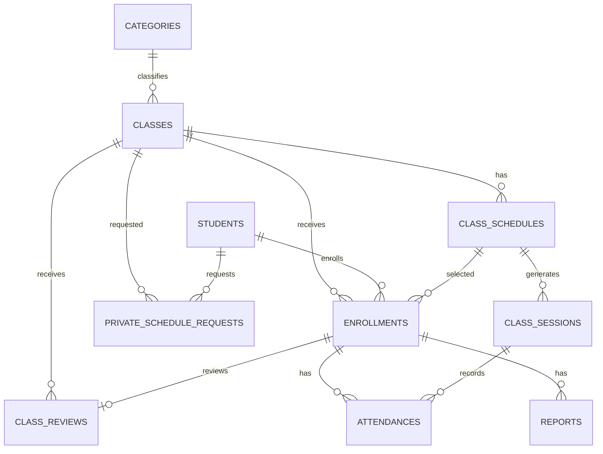

# Academic schema

## Class editor invariants (KEL-198)

**Implemented:** no migration. Existing `class_teachers` assignments are preloaded into additive `teacher_ids` reads and replaced under the class lock in the same transaction as class/category updates. Existing schedule capacity/location/tutor columns are copied or overridden into a new effective-date version; pending/active enrollment links move atomically. The schedule lock serializes with seat reservations; affected session locks protect history checks. Sold enrollment amounts, completed sessions and attendance rows are not rewritten. Unoccupied schedule deletion remains soft deletion. Evidence: academic `class_repository.go`, `schedule_change_guard.go`, `schedule_usecase.go`, `class_editor_postgres_test.go`.

**Implemented migration authority:** `kelolakelas-academic-service/migrations/00000000000000_init_schema.up.sql` plus subsequent migrations including `00001790600000_private_schedule_requests.up.sql` (KEL-107), `00001790600001_private_schedule_recommendations.up.sql` (KEL-115), `00001790812223_add_rescheduled_from_to_class_sessions.up.sql` (KEL-134: nullable self-FK `class_sessions.rescheduled_from_session_id` linking a reschedule replacement to its origin session, partial index, no backfill), and `00001790890000_class_reviews.up.sql` (KEL-159).

| Table | Current key facts |
|---|---|
| `categories`, `classes` | tenant IDs; class FK to category; soft deletes; catalog composite index |
| `students` | parent ID, personal fields, soft delete |
| `private_schedule_requests` | UUID primary key; tenant, class and student IDs (class/student FKs), parent ID and email, billing cycle, JSONB weekly slots, optional note and rejection reason, status (`pending`, `approved`, `rejected`, `declined`, `cancelled`), created/decided timestamps. KEL-115 adds nullable JSONB `recommended_slots` for tenant offers; `declined` records a parent-declined recommendation. Partial unique index on `(student_id, class_id)` where `status = 'pending'`; tenant/status and parent/created indexes support scoped lists (KEL-107). The request row stores approval state and resulting enrollment reference; no enrollment or invoice is created merely by submitting a request. |
| `enrollments` | student/class FKs; schedule FK; unique non-null idempotency key; partial unique active/pending student/class. Status `dropped` is also what billing-driven seat release writes when a payment fails or expires, which frees the seat because the capacity predicate counts only `pending`/`active` (KEL-26, [ADR 0012](../adr/0012-release-enrollment-seat-on-failed-payment.md)). Since KEL-149 the lifecycle also includes `suspended`, written only by the internal suspend endpoint and likewise seat-free; resume reclaims the seat under lock and end writes `dropped` ([ADR 0050](../adr/0050-enrollment-suspend-resume-end.md)) |
| `class_reviews` | UUID primary key; required enrollment and class FKs; unique `enrollment_id` (one review per enrollment); rating smallint CHECK 1–5; nullable comment with `char_length <= 2000`; created/updated timestamps and `(class_id, created_at DESC, id DESC)` index for public pagination. Existing reviews are retained if enrollment later drops; new writes require active/completed ownership. KEL-159 migration `00001790890000_class_reviews.up.sql`, [academic PR #45](https://github.com/kelolakelas/kelolakelas-academic-service/pull/45), squash `641311f1c42f349880d988af929e5fe01c33ac5b`. |
| `class_schedules`, `class_sessions` | schedule capacity positive; class FK; schedule/session enrolment FKs added conditionally. `class_schedules.sessions_generated_until` (DATE, internal) is the last date already generated; partial unique index `uq_class_sessions_schedule_date (schedule_id, session_date) WHERE schedule_id IS NOT NULL` covers soft-deleted/cancelled/rescheduled rows too (migration `00001790492411`, KEL-90, [ADR 0042](../adr/0042-rolling-session-generation-horizon.md)). Since KEL-134 `class_sessions.rescheduled_from_session_id` (nullable self-FK, partial index `idx_class_sessions_rescheduled_from`) links a reschedule replacement to its origin session so its cohort resolves without a schedule; pre-migration replacements keep NULL and use the status fallback ([ADR 0052](../adr/0052-reschedule-replacement-origin-link.md)) |
| `attendances`, `student_notes`, `reports` | attendance unique `(session_id,enrollment_id)` — since KEL-134 the bulk upsert (`POST /api/v1/attendance/bulk`) writes whole sessions against it idempotently, rows carrying the session's own date; reports have enrollment FK and soft delete |
| `tenant_location_snapshots`, `seed_versions` | public-catalog tenant-location cache; seed tracking |

`class_schedules.capacity` is the current write target; `classes.capacity` is retained for compatibility according to migration `000004`. All times were migrated to PostgreSQL `time` in `00001786681222`.

## Class creation retry records (KEL-196)

**Implemented:** `class_creation_requests` uses composite primary key `(tenant_id, request_key)`, SHA-256 `payload_hash`, JSONB `response` and `created_at`. Migration `00001790900001` creates the table, with a unique version after the private payment-method migration; KEL-204 fixes the former duplicate `1790900000`. Existing retry rows survive migration reapplication and application down-versioning ([ADR 0070](../adr/0070-unique-class-creation-migration-version.md)). A successful aggregate and its response commit together; a failed transaction leaves no key. There is no cleanup/expiry policy in this change. Evidence: academic `internal/repository/class_creation_store.go` and migration.

## Parent notification persistence (KEL-155)

**Implemented:** nullable `enrollments.parent_email` stores the verified-token email on new public enrollment or private-request approval only; it is hidden from API JSON and legacy rows remain null. `parent_notification_outbox` contains `id`, `event_id`, `tenant_id`, `parent_id`, `channel`, recipient/sender email snapshots, plain-text body, `status`, attempts, due/first-attempt/sent/created timestamps, lease token and redacted error code. `(event_id,parent_id,channel)` is unique. Status progresses pending → sending → sent (provider accepted), or pending/failed on uncertainty. Sent does not mean delivered. The sender address freezes when first configured on a claim. Neither addresses nor message content are emitted in worker logs.

Migration `1790900002` adds the table, recipient/cohort functions and session/attendance triggers; the idempotent current-schema initializer also includes the nullable email column for bootstrap fixtures. Apply the actual migration on existing deployments. A down migration refuses to discard any outbox history. Session/cohort selection, sibling grouping, absence transitions and delivery claims are tested with PostgreSQL, including rollback and concurrent claims. [ADR 0072](../adr/0072-parent-session-notification-outbox.md).

## Session reminder coverage (KEL-156)

**Implemented:** migration `1790900003` adds `session_reminder_enrollments(session_id, enrollment_id, event_id, created_at)`, with primary key `(session_id,enrollment_id)`, local foreign keys and an event index. The deterministic session event ID identifies reminder rows in the existing notification outbox; there is no second delivery queue. `session_reminder_covered(session,enrollment)` follows same-class origin links with cycle protection and reports existing coverage for the session or its reschedule ancestors. No existing enrollment or outbox row is backfilled.

A single materialized eligible-recipient CTE inserts outbox snapshots and coverage markers atomically under session locks. Only newly uncovered enrollments participate; siblings share the outbox parent/channel event key. A marker records capture/coverage, not delivered email. The dispatcher can classify stale reminder rows as `failed` with `last_error=reminder_no_longer_eligible`; existing non-reminder notifications retain their previous behavior. Down migration refuses to erase coverage once it exists, preserving restart/re-upgrade idempotency. [ADR 0073](../adr/0073-wib-session-reminders.md).

## Private request event and outbox (KEL-226)

**Implemented:** migration00001790900004 adds `private_schedule_requests.chat_version` and immutable `private_request_chat_events` unique(request_id,version), with scoped human actor, transition snapshot, slots/recommendation/reason and capture time. `private_request_chat_outbox` is keyed by event ID, with pending/sending/sent/failed/superseded state, attempts, available_at, lease_token, bounded last_error and sent_at. Capture occurs in the business transaction; rollback removes both event and intent. Claim uses SKIP LOCKED,90s leases and token-fenced completion. Older pending/sending/failed events hold newer events of the same request. No historical actor backfill. [ADR0082](../adr/0082-durable-private-request-chat-events.md).
