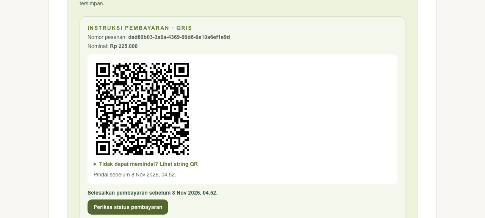
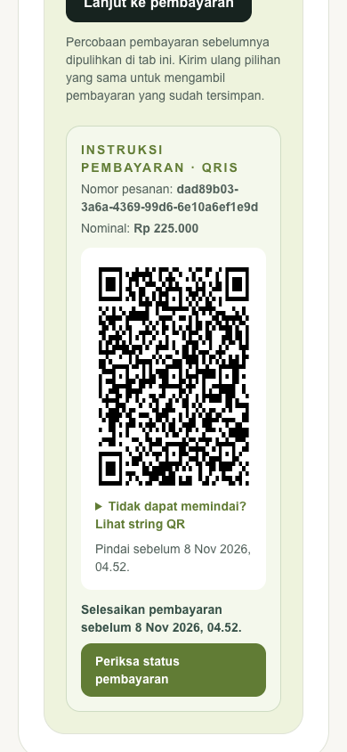

# KEL-216 — group checkout and recovery

## Observed baseline

The reported public class URL was checked through the actual gateway: its type is `group`, enrollment is open and it has selectable schedules. No inference from an old fixture mapping was used to classify it. The 24 October reported-run log at 08:18:32 WIB contains academic `generate enrollment invoice` → billing 500 and billing `Duitku inquiry failed with status 404`. The billing credentials were empty in that process; KEL-215 records the contemporaneous credential-free `Merchant not found` probe and later successful credential/restart verification. This is current-run evidence, not an assumption from KEL-194's historical provider failure.

A new synthetic parent checkout on the reported URL was submitted with billing paused. The browser retained student/schedule/VA after the server error, but reload changed the checkout UUID and reset the selections. Recovery through the gateway with the original key then succeeded against the real Duitku sandbox. No user request was reset or backfilled.

## Implemented recovery

Web preserves the latest submitted attempt per parent/class in tab session storage, before dispatch. Reload restores its original UUID and selection fields, including when the reserved schedule is now full. The draft is schema-validated and bounded; it never authorizes a request or supplies price. Storage denial has explicit no-reload guidance. The manually dispatched action's own pending state disables double submit. Missing enrollment identity or incomplete VA/QRIS instructions is a retryable failure with the submitted choices, rather than complete success.

Source: web `lib/checkout-attempt.ts`, public class `page.tsx`, `_components/EnrollmentPanel.tsx`, `_actions/actions.ts` and their tests. [ADR 0074](../adr/0074-checkout-recovery-after-reload.md) records the decision and limits. No API, pricing, fee, voucher, payment-channel policy or migration changed.

## Validation

Web Vitest: 1,784 passed, 8 unrelated integration tests skipped. Targeted coverage includes original KEL-194 retention, reload identity/payload, account separation, corrupt/denied storage, full-schedule retry, pending-submit and incomplete-payment routing. TypeScript, ESLint, whitespace and production webpack build passed. The required GitHub gate independently runs the default production build before merge.

Existing academic enrollment/idempotency/ownership/fee/voucher/payment regressions and billing invoice/voucher/provider adapter regressions passed with the race detector. Disposable-DSN tests were not run or claimed as executed. Real persistence acceptance is recorded below; no production provider deployment or real-money settlement is claimed.

## Real production-build acceptance

On the reported class URL, the synthetic Bima checkout was submitted while billing was unavailable. After billing resumed, a full reload restored byte-for-byte identical form fields and idempotency key. Clicking the restored submit produced VA instructions on the same class URL through the real gateway/academic/billing/Duitku sandbox path. Two simultaneous subsequent gateway replays returned HTTP 201 with identical enrollment and transaction IDs.

Read-only PostgreSQL verification for that purchase: one enrollment, one pending/active student-class reservation, one associated shared schedule, one billing transaction. No new private schedule/session is allocated by this group checkout. The earlier baseline fixture purchase was separately recovered using its original key; no reset/backfill was used.

A separate synthetic card checkout on the reported URL reached the backend-issued hosted sandbox card URL in the browser; no card details or payment were submitted. The real QRIS attempt exercised a provider timeout instead: academic's bounded billing call was cancelled after roughly ten seconds, and the UI kept a retryable error plus its original choices/key. Readiness remained healthy. QRIS happy-path routing/instructions are covered by automated tests; the current sandbox QRIS attempt is not claimed as a successful payment flow. The existing invoice-claim timeout/retry contract is preserved rather than reset or bypassed. Tenant-owner checkout is rejected with 403; student ownership refusals are covered by the existing academic regressions.

The billing public list deliberately omits method/instructions while a transaction is `creating`; absence there is not evidence that the persisted channel was lost. Source persists the selected method before provider I/O. The existing ten-minute claim timeout remains in effect if the cancelled request cannot release its claim, preventing a concurrent retry from issuing another invoice during an uncertain result.

A single signed provider status lookup after the QRIS timeout returned HTTP 200 / statusCode 01 with a reference, confirming a pending provider order. Read-only PostgreSQL verification confirmed the selected NQ snapshot was persisted and only one enrollment/reservation/transaction existed. No claim timestamp, invoice row, method or expiry was edited to accelerate recovery.

## Initial acceptance blocker and owner-approved investigation

A same-key browser retry after the configured ten-minute lease elapsed again hit academic's ten-second billing-client deadline (19:10:06 WIB). The QRIS order remains uncertain/pending; no claim, invoice method, expiry or reservation was reset to force success. This is not a completed real QRIS happy path. Web and docs PRs are reviewable with green required gates, but KEL-216 must not be treated as fully delivered until this blocker is resolved or the scope is explicitly clarified. A change to the cross-service timeout budget is a material operational/architecture choice and was raised under the execution prompt's scope-clarification rule.

## Historical timeout investigation and external NQ blocker

The owner authorized timeout-budget changes. Academic branch `b4ea35c` raises its billing client to 40 seconds, validates write/shutdown bounds above it, defaults shutdown to 45 seconds, and patches its Go minimum/toolchain to 1.26.10/1.27.3. Local existing settings were coordinated to provider 30 / academic 40 / gateway 50 / write 60 seconds, with gateway drain 55. Readiness stayed healthy. Full academic formatter/module/vet/race/build/vulnerability checks passed; the final vulnerability scan reports zero reachable findings. [ADR 0075](../adr/0075-checkout-timeout-budget.md) records rollout requirements and unchanged billing shutdown/claim behavior.

The old QRIS order's same-key request under this profile still reached provider timeout at 30 seconds, but academic was no longer the first deadline and claim cleanup was not cancelled by it. To distinguish old-order replay from channel availability, a separate synthetic student/new NQ order was submitted through the actual gateway → academic → billing → provider chain. It returned HTTP 500 in **16.74 seconds**, gateway request ID `c8994c16bef3c9789dfb244d2b0e32ed`. Billing logged `Duitku inquiry failed with status 500`; academic returned billing's failure. This is an actual upstream error inside the new budget, not proof of successful QRIS acceptance. No invoice/claim/method/expiry reset or backfill was used.

Two additional isolated signed sandbox inquiry controls used fresh synthetic order IDs and a non-empty customer name. Keeping the application's 20,160-minute expiry returned provider HTTP 500 in 16.57 seconds; using the documented QRIS maximum of 60 minutes also returned HTTP 500 in 16.36 seconds. Neither missing customer name nor excessive expiry alone explains the observed failure. These probes created only sandbox orders, did not modify existing application invoices, and do not establish a new expiry policy. The [official Duitku API reference](https://docs.duitku.com/api/en/) was checked for the required name and QRIS expiry limit. Any channel-specific expiry-policy change remains outside this timeout correction.

At that stage KEL-216 remained In Progress and web #124, academic #62 and docs #223 were held pending QRIS acceptance. This delivery gate is superseded by the owner-approved new-purchase routing and real SP acceptance recorded below. Operator follow-up is to verify merchant-project NQ sandbox health/availability with Duitku; the app must keep the original retry identities and treat provider errors as failures. VA and hosted-card acceptance, reload identity retention and no-duplicate persistence evidence above remain valid. No third issue was started.

## Resume audit — 25 October 2026 (Asia/Jakarta)

The owner explicitly requested resuming KEL-216. All relevant origin/main refs were fetched; web/docs main were fast-forwarded, then the existing PR branches merged the new baseline. Documentation append conflicts were resolved retaining KEL-216 and the newer KEL-217/218/219/220 sections. Academic's issue branch already contains current main. Existing user planning drafts remain untouched. No change to invoice rows, claims, methods or expiry.

A fresh NQ sandbox inquiry with a new synthetic order and 60-minute expiry again returned HTTP500 in16.71s. The provider's authenticated active-methods endpoint returned HTTP200/code00 and explicitly listed NQ as NOBU QRIS, alongside SP as SHOPEEPAY QRIS. A further NQ request returned the sanitized provider message `Failed to generate QR String Nobu`, HTTP500 in16.49s, with no QR/reference. Thus an absent method listing is not the explanation.

A paired control used complete documented customer/contact/item payload fields, amount225000 and expiry10, independent new sandbox order IDs, identical merchant configuration and the current HMAC signature. NQ returned HTTP500 in16.84s with `Failed to generate QR String Nobu`; SP returned HTTP200/code00/SUCCESS in2.42s with QR and reference. This demonstrates a channel-specific upstream failure under the tested conditions; it does not authorize replacing an existing NQ invoice. No real-money settlement. The owner was asked whether new group-checkout QRIS may use the already-supported SP channel; no routing policy is changed until that scope decision.

Reference: [Duitku Direct API](https://docs.duitku.com/api/en/) documents the authenticated active-method list, HMAC signature and both QRIS codes. Raw credentials, full provider bodies, QR strings and invoice identifiers are excluded from this evidence.

A final SP control matched the application's current request shape: empty customer VA name, parent@example.test, existing callback/return URLs, amount225000 and expiry20160 minutes. It returned HTTP200/code00/SUCCESS in3.11s with QR/reference. This proves compatibility for invoice issuance under the tested configuration; it does not establish the upstream QR's effective lifetime or change application expiry policy.

After merging current main, web1854 tests passed with8 unrelated opt-in skips; lint/types/production webpack build passed and production audit reported zero vulnerabilities. Academic module verification, vet, race tests and build passed with loopback-enabled test permissions; formatter output was empty. Govulncheck reported zero reachable findings. Existing billing usecase/provider race regressions passed. Initial sandbox-only Go attempts failed to bind local httptest sockets; the permitted reruns passed, so those failures are not represented as application regressions.

## Owner-approved resolution and final acceptance — 25 October 2026

The owner explicitly chose: use SP for new QRIS purchases, preserve existing NQ invoices. Web revision `2caf257` applies this only to new group checkout. Private request-first/options remain unchanged. The group radio emits SP for a new purchase; a restored/error-echo NQ purchase for the same student retains NQ and its original UUID. Choosing another student starts a distinct SP purchase/key; returning to the old draft restores NQ/key again. Backend invoice-method snapshots remain authoritative. No existing invoice, claim, method, expiry or reservation was rewritten.

**Real successful QRIS:** a new synthetic parent/student on the exact reported class URL selected QRIS in the production build on3021. Browser → server action → actual gateway → academic → billing → Duitku sandbox generated an SP invoice and displayed a complete rendered QR in KelolaKelas, without hosted redirect. Both desktop and mobile viewport screenshots are recorded below. A full reload restored all form fields and the identical idempotency UUID. Retrying in the browser returned QR instructions for the same purchase. Two concurrent gateway replays each returned HTTP201 and the same enrollment/transaction.

Read-only PostgreSQL verification after these retries: one enrollment, one pending/active student-class reservation, one shared schedule and one billing transaction with saved methodSP; zero new private sessions. A pre-existing NQ purchase still had one enrollment/reservation/transaction and saved methodNQ. A production browser seeded with the original validated NQ draft restored methodNQ and its original UUID. These checks verify no conversion or duplicate creation; they do not claim that the failing Nobu provider channel was repaired.

Final local web validation:1856 tests passed,8 unrelated opt-in integration tests skipped; clean lint, TypeScript, production webpack build and whitespace checks; production audit zero vulnerabilities. Existing full academic Go gates and billing/provider race regressions passed as above. New regressions cover SP new checkout, unchanged private options, NQ legacy retry/key and selecting another student then returning to the original purchase.

Remaining operational limits: NQ provider generation still fails; existing NQ orders require provider recovery and must not be switched automatically. No payment was settled. Application invoice expiry policy is unchanged; successful issuance does not independently verify the effective upstream QR lifetime. The coordinated timeout/deployment profile remains required as described in ADR0075; a production deployment of the Go service is not claimed. This evidence supersedes the earlier NQ-specific completion blocker under the owner's explicit routing decision.

