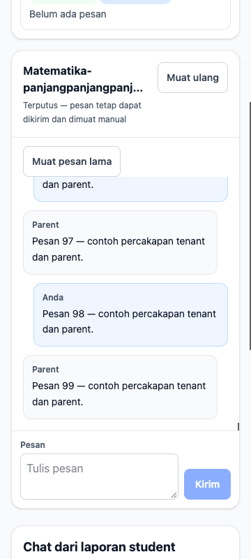
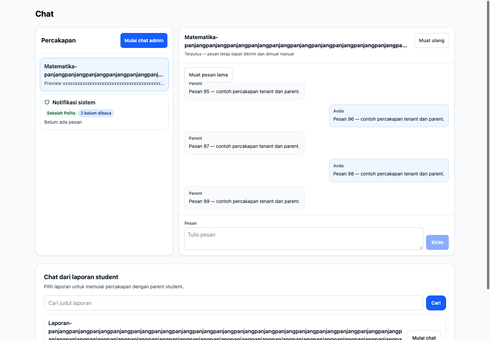

# KEL-202 chat layout validation

**Implemented:** source web `ef579b5d2532f9522bd5c8c2695214f656abbc64`, 16 October 2026 (Asia/Jakarta).

Local commands: `npm run test` (1715 passed; six pre-existing class wizard/editor integration tests skipped for absent dedicated configuration, not counted as passing), `npm run lint`, `npx --no-install tsc --noEmit`, `npm audit --omit=dev --audit-level=high` (zero vulnerabilities), `npm run build` (Turbopack), touched-file Prettier check and `git diff --check` passed.

The chat-specific suite ran 27 tests including tenant/parent fallback sends and same-id retry, reconnect, stale-alert recovery, deep links, notification-only rendering/unread, loading/empty, long text and older-message cursors. Existing report search/pagination/permission tests also passed.

**Observed browser evidence:** Chrome headless rendered the actual ChatInbox and ReportChatPicker components with Tailwind and deterministic synthetic action adapters. Eighteen combinations passed: widths 320/360/1440 CSS px and tenant/parent/empty/error/loading/notification states. DOM geometry checks found no horizontal overflow, message scroll contained in its panel and composer within the panel bounds. Tenant and parent controls exercised send failure/retry recovery, older messages and Tab from message list to composer. Light/dark styling and zero browser exceptions checked. Long unbroken 1800-character message and long room/report titles were included. Screenshots were visually inspected.

This is isolated UI evidence, not a live gateway/chat-service/database end-to-end test. Existing API/action tests cover the retained transport contract; no production data, migrations or application database writes were used. No API, role, transport or notification policy changes. Mobile software-keyboard behavior is represented by viewport constraints, not a physical-device check.

Commands for the temporary browser fixture: `node /private/tmp/kel-batch/visual202/build.mjs` then `node /private/tmp/kel-batch/visual202/check.mjs`; fixture scripts and detailed geometry are retained locally under `/private/tmp/kel-batch/visual202/` for this session.

