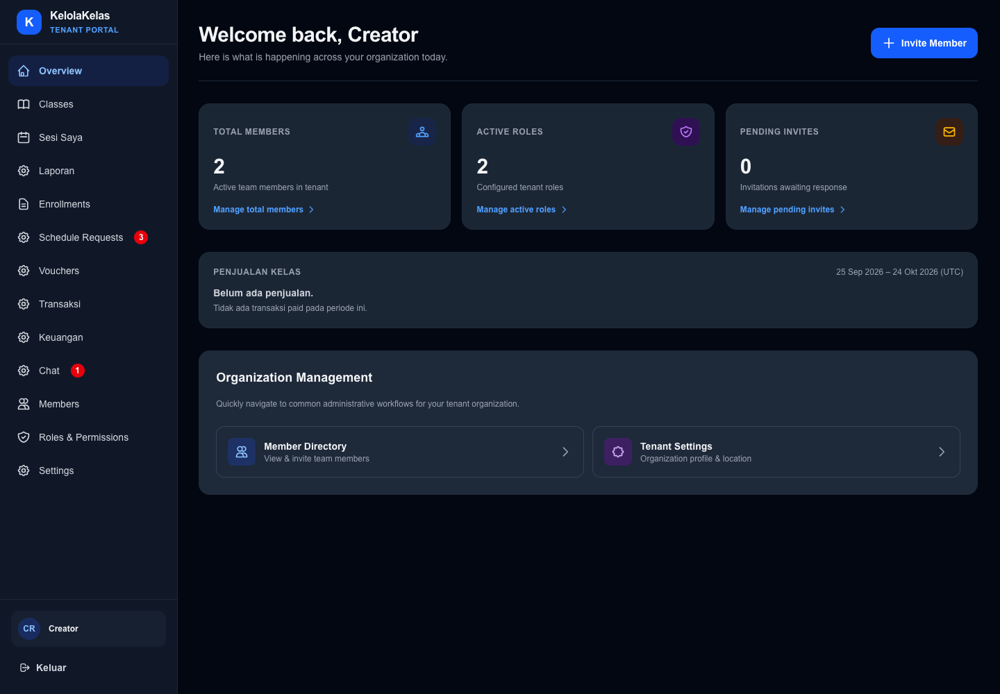
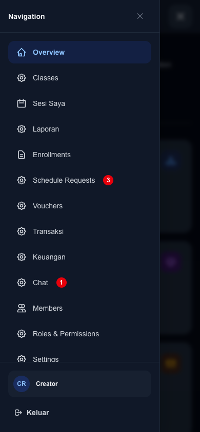

# KEL-218 acceptance — 25 October 2026 (Asia/Jakarta)

**Implemented and verified locally:** pending-only schedule-request badge on production web, gateway, academic and PostgreSQL. No production deployment is claimed.

## Selection and baseline

Fresh Linear discovery returned 216 issues including archived, completed and canceled, with no next page; all full descriptions and native relations were read. Seven unfinished issues: KEL-216, KEL-218, KEL-219, KEL-100/101/102/104. KEL-216 is active with open web124/academic62/docs223 and unresolved real NQ acceptance; excluded. KEL-100/101/102 have unverified required staging rollout/secret-manager dependencies; KEL-104 depends on them. Their completed KEL-93/96/97/98/99 ancestry was traced: all 18 linked PRs are merged into main and their GitHub-reported merge commits reachable from fetched origin/main.

KEL-218 and KEL-219 have empty native blockedBy, no additional blocker, no comments indicating ownership and no open implementation PR. Related Done issues are explicitly not blockers. Neither opens a backlog descendant; both are Medium; estimates 2 versus 3 select KEL-218 first. Targets: web and docs. Both started from fetched, fast-forwarded main; academic's existing KEL-216 branch and user's untracked planning drafts were preserved. No stacked PR or orchestrator repository work. Main protection in web/docs requires an up-to-date `gate`, PRs, no force pushes, enforced for admins; required approval count is zero.

## Local validation

- `npm test`: 164 files passed, 3 skipped; 1,823 tests passed, eight unrelated opt-in integration tests skipped.
- `npm run lint`, `npx tsc --noEmit`, `npm run build -- --webpack`, `git diff --check`: passed.
- `npm audit --omit=dev --audit-level=high`: zero vulnerabilities.
- Focused count/provider/dialog suite: 41 passed, covering boundaries 0/1/99/100/140, authoritative pending filter, stale scope, permission removal, cross-tenant/malformed/unfiltered data, HTTP401/403/500, connection failure/recovery and ten-second off-page polling.
- Chrome desktop1440×1000 and mobile390×844: shared badge and existing Chat badge coexist, no horizontal overflow. Browser-family universality is not claimed.

## Real flow

A fixture parent created three synthetic students and private requests through gateway → academic → PostgreSQL. Backend responses and desktop/mobile both showed three pending. While admin was on Overview, parent cancellation reduced the badge to two through reconciliation. The approved list filter still showed two pending in navigation. Rejecting a fixture via the web dialog reduced it to one. Approving the final fixture via the web dialog returned a real BC sandbox payment link; the badge reached zero while the payment-link dialog remained available. Browser offline mode changed the zero badge into an unavailable indicator without blocking navigation; reconnect restored confirmed zero. No real-money settlement. Approved/rejected/cancelled records were excluded by the backend pending filter.

Automated tests cover 99+ and authorization boundaries without mass-creating fixtures or changing real memberships. The local services may contain unrelated KEL-216 timeout work; KEL-218 uses the unchanged pending-list API, whose tenant predicate, status filter and Limit(100) were also checked on main.

