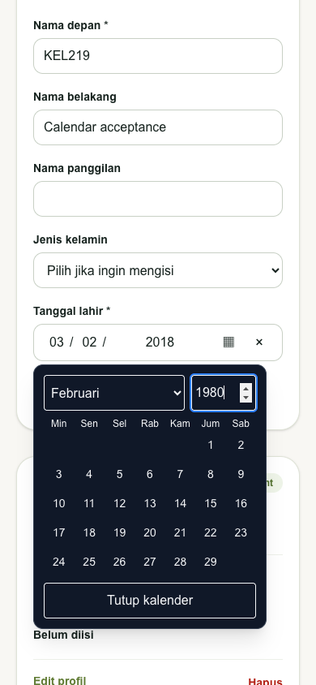
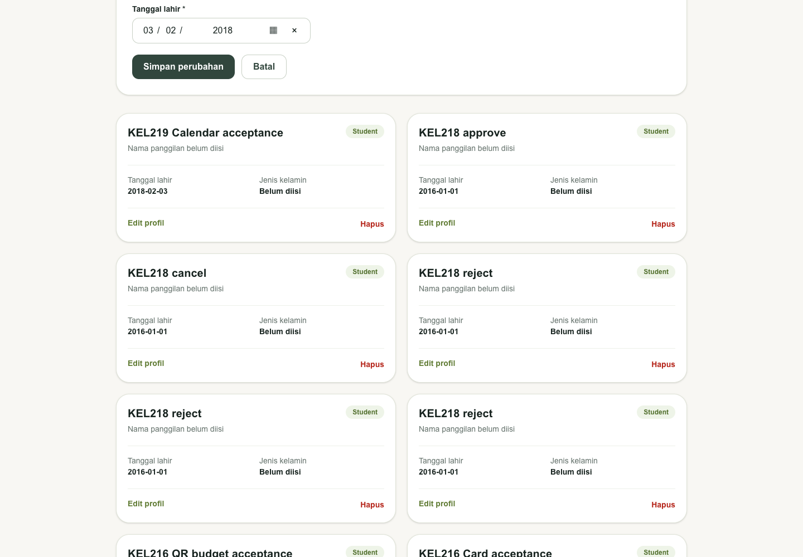
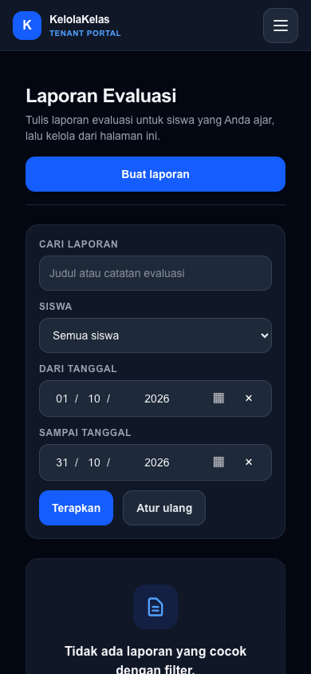
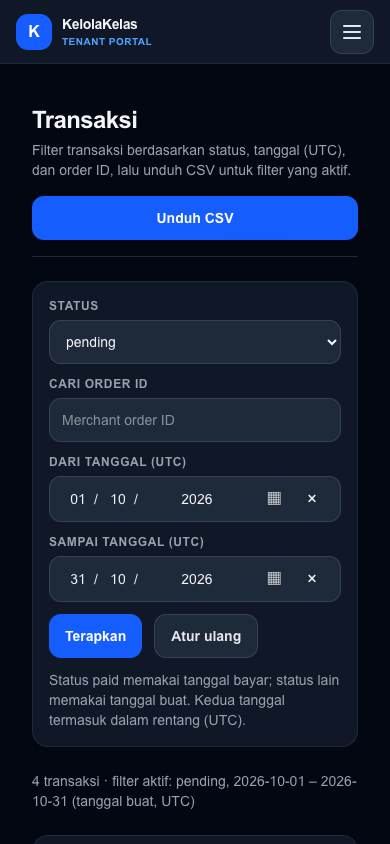
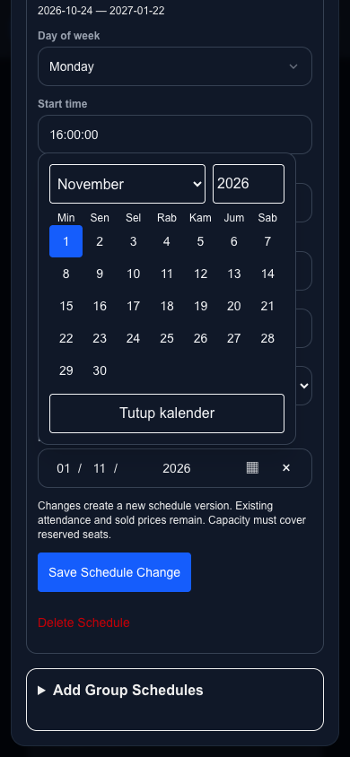
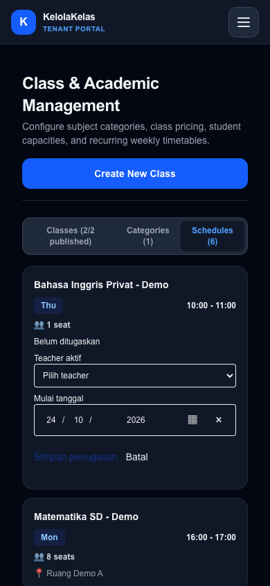
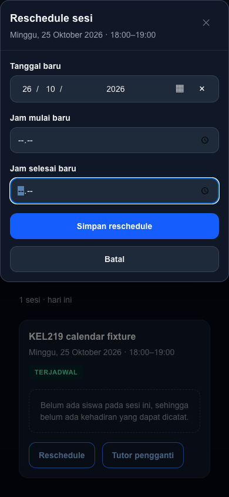
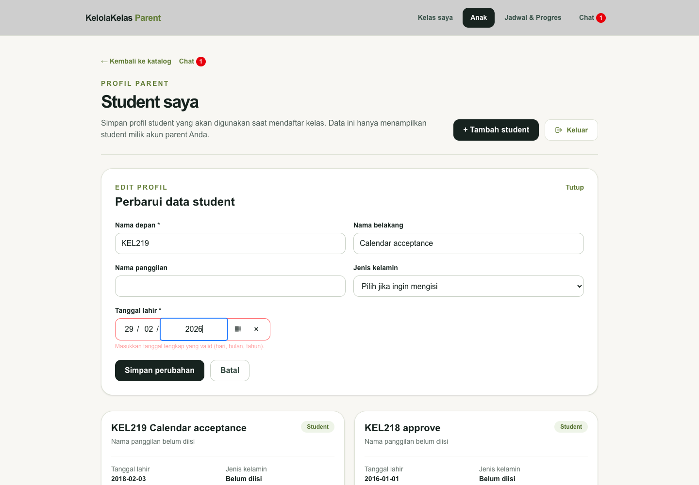

# KEL-219 acceptance — 25 October 2026 (Asia/Jakarta)

Source web revision `e2f55a0` (KEL-219 implementation).

**Implemented:** shared segmented date entry and direct-year calendar across all active source date inputs. Local production build and real synthetic backend flows were checked; no production deployment is claimed.

## Fresh second-task audit

Task1 KEL-218 was Done only after web127/docs226 merged to main and both commits were reachable from refreshed origin/main. Its required PR gates, post-merge main gates and Vercel deployment succeeded before this discovery.

A new full Linear discovery read 216 issues with no next page, including archived/completed/canceled, then fetched full descriptions/native relations and unfinished-issue comments again. All seven allowed repository baselines were fetched. Six unfinished issues remained: KEL-216, KEL-219, KEL-100/101/102/104. The only open PRs remained KEL-216 web124/academic62/docs223, with its real NQ acceptance unresolved. KEL-100/101/102 still lacked verifiable required staging rollout/secret-manager integration; KEL-104 remained blocked by those issues.

KEL-219 was the only eligible issue: no native blockedBy, no additional blocker, no active assignee/delegate/comment or open implementation PR, clear testable outcome, web implementation. Related KEL-175/201/210 are explicitly not blockers. It opens zero backlog descendants; Medium priority, estimate3. Web/docs were checked out and fast-forwarded to main f9bc5d2/0848212 before branching. Existing academic KEL-216 branch and untracked user planning drafts were preserved. No task3, stacked PR or orchestrator work.

## Migration inventory

| Component | Date fields / payload | Verification |
| --- | --- | --- |
| parent students `StudentForm.tsx` | create/edit DOB `date_of_birth` | Chrome desktop/mobile auto-advance, prefill/reset regression, real create/edit API YYYY-MM-DD roundtrip, future max via form/component regression |
| tenant reports `ReportFilterBar.tsx` | from/to `date_from`, `date_to` | desktop/mobile, actual GET URL 2026-10-01 through 2026-10-31, existing range/schema tests |
| tenant transactions `TransactionFilterBar.tsx` | UTC from/to `date_from`, `date_to` | desktop/mobile, URL and canonical values preserved |
| tenant sessions `RescheduleDialog.tsx` | `new_session_date` | mobile/desktop, real web submit and one replacement at 2026-10-26T00:00:00Z |
| tenant classes `AssignTeacherForm.tsx` | controlled initial-assignment effective date | mobile rendering with schedule bounds and existing payload/action tests |
| tenant classes `ClassConfigurationEditor.tsx` | controlled version effective date | desktop/mobile modal, bounds and calendar, existing editor/action regressions |
| tenant vouchers `VoucherDateTimeField.tsx` | both valid-from/valid-until date halves, existing hidden instant payload | desktop/mobile, UTC/WIB display and exact fractional instant roundtrip, day defaults and date-only edits in tests |

Inventory searched app/components TS/TSX for native date/datetime-local and dynamic date types. Nine source input declarations across seven components, including the voucher component reused for both boundaries; no active native date/datetime-local input remains. Time-only controls and backend policies are unchanged.

## Automated validation

- Full Vitest:167 files passed,3 skipped;1847 tests passed,8 unrelated opt-in integration tests skipped.
- ESLint clean, TypeScript `npx tsc --noEmit`, production `npm run build -- --webpack`, whitespace check passed.
- Production `npm audit --omit=dev --audit-level=high`: zero vulnerabilities.
- UTC and Asia/Jakarta each ran23 focused calendar/voucher serializer/form tests successfully.
- New regressions cover leap/century dates and years0001..9999, inclusive min/max, required/optional/partial values, invalid paste without stale retention, canonical serialization, focus advancement, correction/backspace/paste/clear, controlled values, external edit default changes, native reset, disabled fields, distant-year calendar selection, arrows across months and Escape focus return.
- Existing DOB, filter-range, session scheduling, teacher assignment and voucher action/schema regressions remain in the full suite.

## Browser / API evidence

Chrome production web3019 → gateway8000 → academic/billing → PostgreSQL, with synthetic local accounts/data only:

- Typing day03 advanced to month, month02 advanced to year. Create saved DOB2018-02-03; edit prefilled the same date and successful edit preserved API2018-02-03T00:00:00Z. Browser UTC and WIB retain that calendar date. The create→reset→edit inspection found and fixed stale uncontrolled defaults; an automated regression now covers it.
- Final production browser paste29/02/2026 displayed the attempted invalid date, produced empty canonical data, false form validity and an associated calendar error instead of retaining the saved date.
- Calendar directly entered year1980 and selected February on mobile, with Escape returning focus to its trigger; labels, error associations and dark/light surfaces were inspected.
- A synthetic voucher held 2026-12-31T21:23:45.123Z and 2027-01-02T02:34:56.789Z. WIB displayed Jan1 04:23:45.123, UTC displayed Dec31 21:23:45.123, with identical hidden instants. An actual unchanged web save confirmed success; the subsequent API read preserved both fractions exactly.
- Report filter submitted exact date_from/date_to query strings; transaction controls kept the UTC calendar labels/payload. Initial teacher assignment and class-version date controls were opened in their actual dynamic forms.
- An isolated synthetic class/session allowed a real reschedule from Oct25 to Oct26. API confirmed original=rescheduled and one matching replacement dated2026-10-26T00:00:00Z. Existing native time fields were populated via DOM input/change events for this date-focused automation. Existing demo schedules were not mutated.

Scope of browser verification: desktop1440×1000 and mobile390×844 viewport; actual screen-reader output, Firefox, Safari and physical mobile keyboards were not tested. Transaction-table horizontal scrolling is existing behavior; the date controls themselves fit the viewport. This work does not redesign tables.

Design and compatibility: [ADR0077](../adr/0077-shared-calendar-date-input.md).
